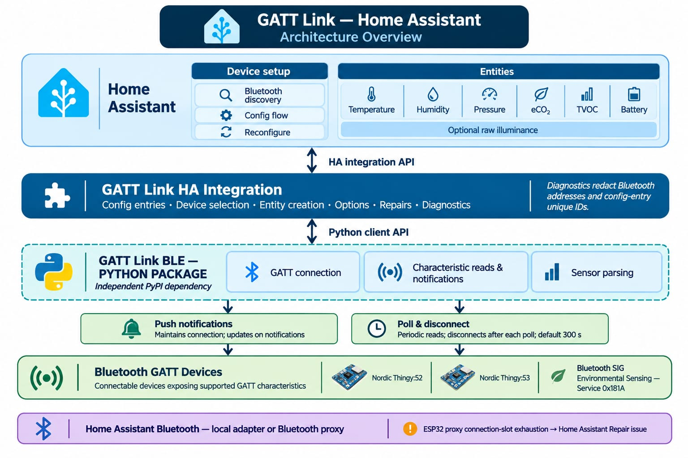

# Architecture

This document is the integration implementation guide for maintainers and contributors.



## Product scope
GATT Link connects supported Bluetooth devices into Home Assistant through the `gatt-link-ble` library. The integration is responsible for discovery, config flow, entity lifecycle, translations, diagnostics, and repair handling.

## Core responsibilities
- Bluetooth discovery and config flow
- coordinator-driven polling and push updates
- sensor entity creation and registry hygiene
- availability and freshness tracking
- diagnostics redaction and repair issue handling
- Home Assistant metadata and marketplace readiness

## Key files
- `custom_components/gatt_link/__init__.py`
- `custom_components/gatt_link/config_flow.py`
- `custom_components/gatt_link/coordinator.py`
- `custom_components/gatt_link/entity.py`
- `custom_components/gatt_link/sensor.py`
- `custom_components/gatt_link/diagnostics.py`
- `custom_components/gatt_link/repairs.py`

## HA compatibility
HACS metadata sets the minimum Home Assistant version to 2026.11. The project requires Python 3.14.2 or newer and uses strict typing and code quality checks.

## Verification
The project validates with:

```bash
uv sync --dev
uv run ruff format --check .
uv run ruff check .
uv run mypy custom_components tests
uv run pytest
```
